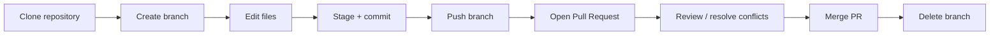

# GitHub Playground

Welcome to the **Merrimack Computer Club**'s GitHub Playground, an open practice space for **Merrimack College** students!

## Purpose

This is a safe place to practice real GitHub workflows by actually using them. There's no application code here, only Markdown files you can freely edit, commit, and revert. You can clone, branch, and merge without worrying about breaking anything.

## Who This Is For

Everyone! Whether you're a senior Computer Science student who uses Git all the time or you're just starting your tech journey, you're welcome here. You don't need to be a Computer Science major or have used a terminal before.

- Students who are brand new to Git and/or GitHub
- Students with some Git experience who want more practice with branching, pull requests, and other collaborative workflows
- Anyone who wants hands-on practice using Git in the command line

## Prerequisites

- [Git](https://git-scm.com/downloads) installed on your machine (`git --version` to verify)
  - **Mac:** Git comes preinstalled macOS. Run `git --version` to verify it was installed.
  - **Windows:** Download and run the installer from [Git for Windows](https://git-scm.com/download/win).
- A [GitHub account](https://github.com/signup), I recommend setting your username to your Merrimack email without the @merrimack.edu for convenience in Merrimack classes that use GitHub (e.g. hajjp for hajjp@merrimack.edu)
- (recommended) An IDE (integrated development environment) such as [VS Code](https://code.visualstudio.com/).

## Skills You Will Practice

| Skill | Exercise |
|---|---|
| Cloning a repository | [Exercise 01](exercises/exercise-01-clone-and-edit.md) |
| Creating branches | [Exercise 02](exercises/exercise-02-branching.md) |
| Staging, committing, and pushing | [Exercise 03](exercises/exercise-03-commit-and-push.md) |
| Opening Pull Requests | [Exercise 04](exercises/exercise-04-pull-request.md) |
| Resolving merge conflicts | [Exercise 05](exercises/exercise-05-merge-conflict.md) |
| Updating documentation | [Exercise 06](exercises/exercise-06-documentation-update.md) |

## Expected Workflow

## Getting Started

You'll need a GitHub account.

1. Read [`PRACTICE_GUIDE.md`](PRACTICE_GUIDE.md) for an overview of the workflow.
2. Take a look at [`CONTRIBUTING.md`](CONTRIBUTING.md) before making changes.
3. Start with [Exercise 01](exercises/exercise-01-clone-and-edit.md) and work through the exercises at your own pace.

## Practice Workspaces

- [`student-profiles/`](student-profiles/README.md) — Add your own profile and meet other students
- [`project-notes/`](project-notes/README.md) — Practice editing shared notes
- [`sandbox/`](sandbox/README.md) — Free-form edits and experiments

## Getting Help

Stuck? Have a question? We're happy to help! Contact us via:

- **Discord:** Join the Merrimack College Division of Computational Sciences Discord Server [here](https://discord.gg/A4DV423ryu)
- **Email:** Contact Peter Hajj, the club president, at [hajjp@merrimack.edu](mailto:hajjp@merrimack.edu)
- **eBoard:** Reach out to any Computer Club eBoard member
